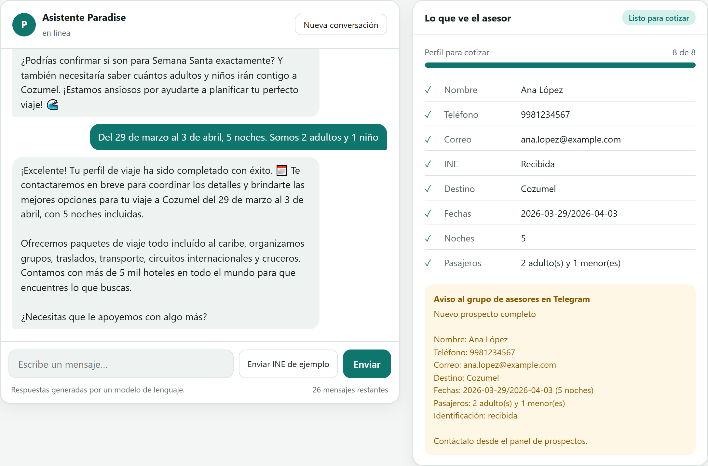
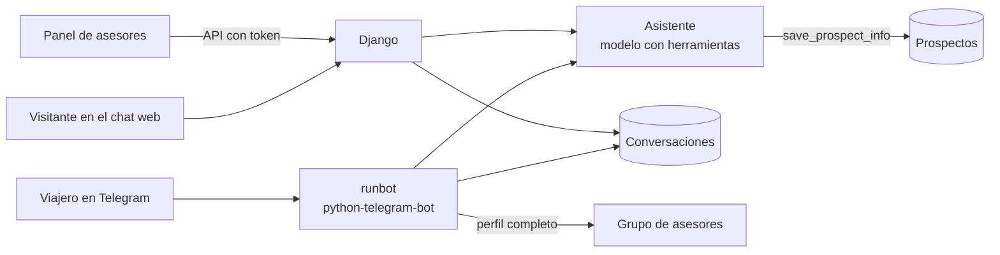

# Paradise Tour: asistente de ventas con IA

[](https://github.com/AngelArteachi/paradise-bot-backend/actions/workflows/ci.yml)

Asistente de ventas de **Paradise Tour Travel Agency** que atiende por
Telegram y desde un chat web, con un backend en Django para el panel de los
asesores.

El asistente resuelve dudas sobre los viajes al Caribe y reúne los datos para
cotizar: nombre, teléfono, correo, identificación oficial, destino, fechas,
noches y pasajeros. Cuando el perfil está completo, avisa al grupo de asesores
y les deja el prospecto listo en el panel.

Proyecto para una agencia de viajes real, hecho en equipo con
[Gonzalo Gamboa](https://github.com/GanzytoX), que desarrolló el panel web de
los asesores. Este repositorio contiene el bot, el chat web y la API que usa
ese panel.

**Stack:** Python 3.13, Django 6, python-telegram-bot 22 (con *job queue*),
*tool calling* con cualquier modelo compatible con la API de OpenAI (OpenAI,
Ollama, Groq o Gemini), SQLite, Docker y GitHub Actions.

<picture>
  <source media="(prefers-color-scheme: dark)" srcset="docs/demo-dark.png">
  
</picture>

## Pruébalo sin llaves

Con Docker, desde la raíz del repositorio:

```bash
docker compose up
```

Abre http://localhost:8000. El modelo corre en tu computadora con
[Ollama](https://ollama.com) (Qwen 2.5 de 7B), así que no necesitas cuentas
de OpenAI ni de Telegram. La primera vez descarga el modelo, unos 4.7 GB.
Con una tarjeta NVIDIA va mucho más rápido:

```bash
docker compose -f docker-compose.yml -f docker-compose.gpu.yml up
```

Con una GPU de 8 GB, cada respuesta del modelo local tarda de 10 a 50
segundos; con un proveedor en la nube (ver [Elegir el modelo](#elegir-el-modelo))
responde mucho más rápido.

## Una conversación real

Con Qwen 2.5 de 7B en local, recortando las respuestas largas:

```text
Asistente: ¡Hola! 🌴 Gracias por comunicarte con Paradise Tour Travel Agency.
           ¿Cómo podemos ayudarle?
Viajero:   Hola, quiero ir a Cozumel en Semana Santa
Asistente: ¡Genial elección! 🏖️ [...] ¿me podrías compartir tu nombre,
           número de teléfono y dirección de correo electrónico? Además,
           necesitaré que envíes una foto de tu INE o pasaporte [...]
Viajero:   Soy Ana López, mi teléfono es 998 123 4567 y mi correo
           ana.lopez@example.com
Asistente: ¡Perfecto, Ana! 🌼 [...] Ahora necesito que envíes una foto de tu
           INE o pasaporte [...] presionando el botón 'Enviar INE de ejemplo'.
Viajero:   [INE de ejemplo]
Asistente: ¡Gracias, Ana! 🎉 [...] necesitaría saber cuántos adultos y niños
           irán contigo a Cozumel.
Viajero:   Del 29 de marzo al 3 de abril, 5 noches. Somos 2 adultos y 1 niño
Asistente: ¡Excelente! Tu perfil de viaje ha sido completado con éxito. [...]
           ¿Necesitas que le apoyemos con algo más?

Grupo de asesores:
           Nuevo prospecto completo
           Nombre: Ana López
           Teléfono: 9981234567
           Correo: ana.lopez@example.com
           Destino: Cozumel
           Fechas: 2026-03-29/2026-04-03 (5 noches)
           Pasajeros: 2 adulto(s) y 1 menor(es)
           Identificación: recibida
```

Los modelos chicos a veces dicen "ya guardé tus datos" sin llamar a la
herramienta, o escriben la llamada como JSON dentro de la respuesta. El
asistente cubre los dos casos: lee esas llamadas escritas como texto y, si el
viajero dio un teléfono o un correo y no se guardó nada, le pide al modelo
una vez que lo guarde antes de contestar.

## Cómo funciona



- **El modelo no escribe en la base directamente.** Guarda cada dato
  llamando a la herramienta `save_prospect_info`, que lo valida con las reglas
  del modelo de Django antes de guardarlo. Por ejemplo, un destino fuera del
  Caribe se rechaza en el servidor, no solo en el prompt.
- **Un asistente, dos canales.** Telegram y el chat web usan el mismo
  `Assistant`; cada canal solo traduce mensajes de entrada y de salida.
- **El historial vive en la base de datos.** Si el bot se reinicia o se
  actualiza, no olvida lo que el viajero ya dijo. En el chat web, recargar la
  página tampoco borra la conversación.
- **Las identificaciones se tratan como datos sensibles.** Se guardan con
  nombre aleatorio, nunca se publican en `/media/` y el panel las abre con un
  enlace firmado que caduca en 5 minutos. Al modelo de visión se le manda la
  imagen directamente, no la URL de Telegram, que incluye el token del bot. El
  chat web nunca recibe identificaciones: usa una INE de ejemplo.
- **El horario de oficina se calcula en código** (lunes a viernes de 10 a 14 y
  de 16 a 18, sábados de 10 a 13, hora de Cancún) y se le da al modelo como un
  hecho.
- **Seguimiento automático.** Si el viajero deja de responder en Telegram, el
  bot le escribe hasta tres veces, cada 15 minutos, y luego se despide. Nunca
  escribe entre las 21:00 y las 8:00.
- **Aviso al equipo.** Cuando un prospecto queda completo, el grupo de
  asesores recibe un resumen (sin la identificación) una sola vez.
- **Un chat público con límites.** El chat web limita los mensajes por
  conversación, por visitante cada hora y en total cada día, para que una
  demo abierta no acabe con la cuota del proveedor, y borra sus datos a las
  24 horas.

## Elegir el modelo

El asistente habla con cualquier servicio compatible con la API de chat de
OpenAI. Se elige con tres variables en `backend/.env`:

| Proveedor | `AI_BASE_URL` | `AI_API_KEY` | `AI_MODEL` (ejemplo) | Para qué |
| --- | --- | --- | --- | --- |
| OpenAI | vacío | `sk-...` | `gpt-4o-mini` | Producción |
| Ollama | `http://localhost:11434/v1` | vacío | `qwen2.5:7b` | Local, gratis y sin internet |
| Groq | `https://api.groq.com/openai/v1` | `gsk_...` | `llama-3.3-70b-versatile` | Demo pública en su capa gratuita |
| Gemini | `https://generativelanguage.googleapis.com/v1beta/openai/` | la de Google AI Studio | `gemini-2.5-flash` | Demo pública en su capa gratuita |

Los nombres de los modelos cambian con el tiempo; revisa la lista actual de
cada proveedor. Leer la foto de la INE necesita un modelo con visión
(`AI_VISION_MODEL`); sin uno, la foto se guarda pero se marca como no
verificada.

## Puesta en marcha

Requiere Python 3.13.

```bash
python -m venv .venv
```

```bash
.venv\Scripts\pip install -r requirements.txt
```

Copia `backend/.env.example` a `backend/.env` y elige el modelo (ver la tabla
anterior). Para Telegram, crea un bot con [@BotFather](https://t.me/BotFather)
y pon su token en `TELEGRAM_TOKEN`; también se pueden capturar desde el panel.
Luego:

```bash
run_api.bat
```

```bash
run_bot.bat
```

Con `DEBUG=true`, el chat web queda en http://localhost:8000.

En Mac o Linux, desde `backend/`: `python manage.py migrate`, después
`python manage.py runserver` y `python manage.py runbot` en otra terminal.

Para crear un usuario del panel, desde `backend/`:

```bash
python manage.py shell -c "from chatbot.models import User; User.objects.create(usuario='asesor', correo='asesor@paradisetour.mx', contrasena='una-contraseña-larga')"
```

## API

### Panel de asesores

Todas las rutas, salvo el login y la descarga de identificaciones, requieren
`Authorization: Bearer <token>`. El token dura 12 horas
(`PANEL_TOKEN_MAX_AGE`).

| Método y ruta | Uso |
| --- | --- |
| `POST /api/login/` | `{usuario, contrasena}` → `{token, expires_in}` |
| `GET /api/settings/` | Configuración del bot. La API key y el token se devuelven enmascarados (`sk-…1234`) con `*_set: true` |
| `PUT /api/settings/` | Guarda la configuración. Si el panel reenvía el valor enmascarado, se conserva el guardado |
| `GET /api/prospects/?stage=` | Prospectos visibles, opcionalmente por etapa. `ine_file_url` es un enlace firmado de 5 minutos |
| `GET /api/prospects/<id>/` | Un prospecto |
| `PATCH /api/prospects/<id>/` | `{stage, advisor_notes}`. Etapas: `new`, `contacted`, `quoted`, `won`, `lost` |
| `DELETE /api/prospects/<id>/` | Lo oculta del panel sin borrarlo |
| `GET /api/prospects/<id>/conversation/` | Lo que se dijeron el viajero y el asistente |
| `GET /api/prospects/<id>/id-document/?signature=` | La identificación, solo con un enlace firmado vigente |

### Chat web

Públicas y activas con `WEB_CHAT_ENABLED=true` (por defecto, solo con
`DEBUG=true`). La sesión es un valor firmado que entrega el servidor.

| Método y ruta | Uso |
| --- | --- |
| `GET /` | La página del chat |
| `POST /api/chat/` | Empieza una conversación → `{session, messages, prospect, messages_left}` |
| `GET /api/chat/state/?session=` | La conversación y el prospecto, para retomar después de recargar |
| `POST /api/chat/messages/` | `{session, message}` o `{session, sample_id: true}` → lo mismo más `reply` y `advisor_notification` |

## Pruebas

```bash
cd backend
```

```bash
python manage.py test chatbot
```

Las pruebas usan un cliente de OpenAI falso con respuestas guionadas, así que
no gastan créditos ni necesitan internet. Cubren la validación de destinos,
el horario de oficina, las herramientas del modelo, el ciclo de la
conversación, el manejo de identificaciones, los *handlers* de Telegram, el
seguimiento automático, la API del panel y el chat web con sus límites.

## Producción

- `DEBUG=false` y un `SECRET_KEY` largo y aleatorio. Sin `SECRET_KEY` la
  aplicación no arranca.
- `ALLOWED_HOSTS` y `CORS_ALLOWED_ORIGINS` con el dominio real del panel.
- Detrás de HTTPS: `SECURE_SSL_REDIRECT=true` y `SECURE_HSTS_SECONDS`.
- `python manage.py check --deploy` debe quedar sin advertencias graves.
- `backend/media/` contiene identificaciones oficiales: respáldalo y
  restringe el acceso al servidor.

### Publicar el chat web

El `Dockerfile` sirve la aplicación con gunicorn en el puerto `PORT`, así que
funciona tal cual en Render, Fly.io o Railway. Configura:

- `SECRET_KEY`, `ALLOWED_HOSTS` con el dominio y `WEB_CHAT_ENABLED=true`.
- Un proveedor con capa gratuita (Groq o Gemini, ver la tabla) en
  `AI_BASE_URL`, `AI_API_KEY` y `AI_MODEL`.
- `WEB_CHAT_PROXY_HOPS=1`, para que los límites se apliquen por visitante y
  no a la dirección del proxy de la plataforma.
- Ajusta `WEB_CHAT_DAILY_LIMIT` a la cuota de tu proveedor.

Los límites se guardan en la memoria del proceso, por eso el contenedor corre
un solo proceso con varios hilos.
